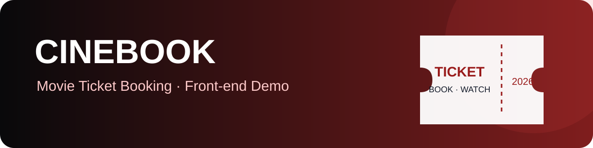
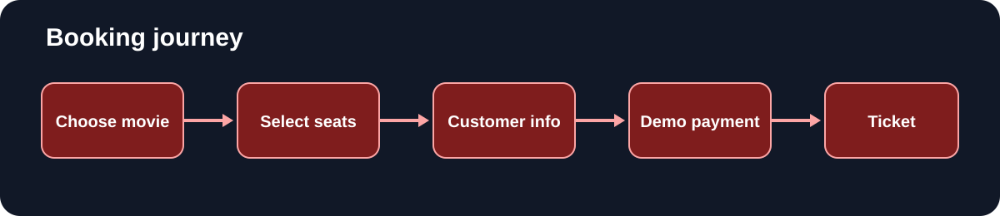

# CineBook — Movie Ticket Booking Demo

<p align="center"></p>

<p align="center"><strong>A responsive front-end movie booking demo built with HTML, CSS and vanilla JavaScript.</strong></p>

## Features

- Movie and show selection
- Silver, Gold and Diamond seat selection
- Snack selection and bill calculation
- Customer form validation
- Booking receipt and print view
- Booking history and cancellation
- Admin-style movie and show management
- Browser LocalStorage persistence
- Responsive layout

## Concepts Used

The current implementation keeps HTML, CSS and JavaScript together in `index.html`.

| Concept | Where it appears | What it demonstrates |
|---|---|---|
| Single-page navigation | `showPage()` | Switching between sections without loading a new page |
| DOM manipulation | Page render and update functions | Creating elements, changing text and updating classes |
| JavaScript state | Selected movie, show, screen, seats, customer and booking arrays | Keeping track of the current booking flow |
| Arrays and objects | Movies, shows, seats, snacks and bookings | Representing application data |
| Array methods | `map()`, `filter()`, `find()`, `some()`, `reduce()` | Searching, updating and calculating over application data |
| Event handling | Button and input handlers | Responding to user actions |
| Input validation | Name, mobile, email and quantity validators | Checking user-entered data before processing |
| Seat availability logic | `isSeatBooked()`, `selectSeat()` | Preventing selection of already-booked seats and limiting a booking |
| Billing and arithmetic | `calculateTicketTotal()`, `updatePayment()` | Calculating ticket/snack totals, discount and GST |
| CRUD operations | Admin movie/show functions | Adding and deleting movie and show records |
| Browser storage | `localStorage.getItem()`, `localStorage.setItem()` | Saving and restoring demo data in the browser |
| Date and time | Booking ID and `createdAt` | Generating booking metadata |
| Responsive CSS | Media query in the page stylesheet | Adjusting layout for smaller screens |
| Browser printing | Ticket print view | Formatting a booking receipt for printing |

## Technology

HTML5, CSS3, JavaScript, DOM APIs and LocalStorage.

## Run locally

1. Clone the repository.
2. Open `index.html` in a modern browser.
3. Select a movie, show and seats to explore the demo.

No build step or backend is required for the current front-end demonstration.

## Screens and flow

<p align="center"></p>

## Repository structure

```text
repo07/
├── assets/
│   ├── cinebook-banner.svg
│   └── booking-flow.svg
├── index.html
├── legacy-version.html
├── .nojekyll
├── LICENSE
└── README.md
```

## Security and data limitations

This is a browser-only learning demo. LocalStorage data is stored in the browser and is not a secure database. The admin check is implemented in client-side JavaScript and can be inspected or bypassed; it is not real authentication. Payment choices are simulated and no payment is processed. Do not enter real personal or payment information.

For production use, move authentication, authorization, booking validation and payment processing to a trusted backend, use a database, and implement server-side seat locking.

## Future improvements

- Split HTML, CSS and JavaScript into separate files
- Add automated tests and continuous integration
- Build a backend API and database
- Add accessible keyboard navigation and screen-reader testing
- Replace demo authentication with server-side identity management

## Maintainer

[Anurag Chaurasiya](https://github.com/anuragchaurasiya)